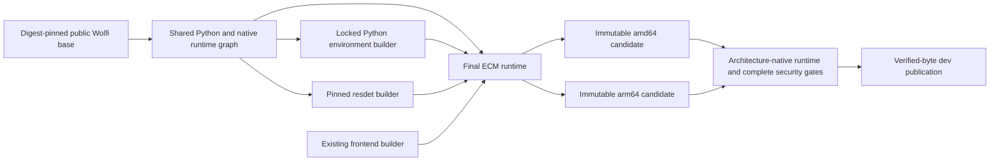

# ADR-015: Source-closed native runtime for security fixes

- **Status:** Source-closed replacement implemented; final publication gates pending
- **Date:** 2026-10-23
- **Bead:** `enhancedchannelmanager-x1xne`
- **Scope:** ECM native runtime; both services receive the bundled-OpenSSL lock
  repair. MCP's image recipe remains unchanged.

## Context

The complete Debian image scan reports 42 unique Critical/High native advisories
across 12 source packages. Supported Debian stable/security/backports do not
provide their fixes. Provider-controlled media reaches FFmpeg/ffprobe, including
affected probing paths. Timeouts and protocol restrictions do not patch decoders.
See [the complete investigation](../security/native-image-triage-20261023.md).

The operator authorized broader native-stack remediation after PR #1038.
The smallest option must preserve the application, Python 3.12, persisted data,
provider transports, preview and optional resdet without maintaining unnecessary
downstream native forks. This is a home-lab application with small-team image
publication rigor, not a new service or orchestration architecture.

## Decision

**2026-10-24 update:** do not publish the current Wolfi recipe or close `x1xne`.
Its scanner result did not establish corresponding-source completeness: installed
recipes reference external patches/configs from private packaging revisions, and
the recovered public candidates do not authenticate those exact inputs. FFmpeg 9
also removes or omits application-reachable software-input integrations. The
operator has not accepted narrower format support.

The replacement experiment builds signed upstream FFmpeg **8.1.3** on a public
openSUSE Tumbleweed graph, explicitly retaining Codec2, JPEG XL, SVG and
game/tracker integrations. The 17 affected files in the signed release archive
match the source inspected for all 16 original FFmpeg fixes. The
[source-review receipt](../security/ffmpeg-8.1.3-source-review-20261024.md) records
the signed release and exact stable fixes. That is source-level evidence, not an
image scan or compatibility result. Stock Fedora/RPM Fusion and
stock openSUSE/Packman were rejected; neither closes the combined security and
format contract. A custom build is not yet an accepted production replacement.

The source-built amd64 native prototype now passes its eight native checks and
the five original rare-input fixtures. Its supported Tumbleweed Trivy report
inventories 212 OS packages with zero High/Critical, retaining one UNKNOWN Go
finding. Actual base source correspondence has separately been checked for all
89 source origins on **each** architecture; ARM source RPMs are not assumed equal
to same-named x86 files. These do not establish final-runtime source closure or
native ARM execution. The application integration/source-delivery work remains
in progress.

The wheel-native review also found a separate statically bundled OpenSSL 4.0.1
copy. Both service locks now select cryptography 50.0.2/OpenSSL 4.0.3, with actual
loaded-library and crypto-operation regressions passing locally. This is a
security fix, not an incidental package-currency upgrade; replacing system
OpenSSL would not repair that copy. Updated notices and final artifact audits
must follow the new wheel identity.

The branch now uses the seven-stage SUSE source-build/source-delivery recipe and
SUSE/RPM scan contract. The original Wolfi graph remains rejected. Matching
sources and final artifact verification are publication prerequisites; a
source-only branch push does not approve binary distribution.

The complete amd64 application experiment passed 27 runtime checks and actual
default/custom UID/GID restart/recreation persistence. Its scan inventories 212
RPM/key entries, 74 Python packages and four Go components with zero High/Critical;
one Medium and one UNKNOWN remain recorded. A separate collector authenticated
all 156 exact SRPMs for its 206 non-key RPM rows (966,679,281 bytes). These are
experiment/source receipts, not final patched-recipe or arm64 execution proof.
Expected public Python-wheel artifacts and notices are audited separately for
both architectures; final-image selection must match those indexes.

### Original prototype decision (not publication approval)

The original implementation used the public Wolfi/glibc package ecosystem and a digest-pinned multiarchitecture
`cgr.dev/chainguard/wolfi-base` input. Resolve one shared `runtime-base` containing
Python 3.12, the FFmpeg 9.0 patch line, libxml2 2.15.4 or newer, and existing
bootstrap utilities. Inherit that stage in both backend builders and the final
runtime. Keep the Python locks and the resdet/KISS FFT source graph unchanged.

The initial reviewed multiarchitecture base digest is
`sha256:f15fea2f49cb14dceaea491fcbde0d35e0c190126a744ac05a9838440d47d994`.
The prototype solved Python 3.12.15, FFmpeg 9.0.2 and libxml2 2.15.4. It passed
16 synthetic-media/native checks and the existing seven-check startup smoke on
amd64. Its complete Trivy 0.76.1 scan detected 102 OS packages, zero OS findings
and zero High/Critical Python findings; one Python Medium remains. **These are
prototype results, not final-source, arm64, relay or publication approval.**

## Alternatives

| Option | Benefit | Reason not selected |
| --- | --- | --- |
| Refresh Debian stable | Smallest operational change | Already rebuilt; applicable Critical/High findings remain without available supported fixes. |
| Stock stable Alpine | Small base; existing MCP familiarity | FFmpeg 8.1.2/libxml2 2.13.9 remain affected; incomplete advisory coverage is not clearance. Also changes libc. |
| Ubuntu/Fedora | Familiar glibc packaging | Available supported/public packages do not close the required graph; beta or paid-only fixes are not the chosen portable baseline. |
| Own FFmpeg/libxml2 and residual native forks | Full source control | More patch, ABI, build, licensing and architecture maintenance than using maintained public packages. Retain as an exit option. |
| Public Wolfi/glibc | Fixed package lines, existing manylinux wheels, public recipes | Selected subject to complete graph scans and actual runtime compatibility. Rolling updates require disciplined maintenance. |

## Acceptance before closure

These are required delivery criteria, not claims that unfinished gates exist:

- Reject altered inherited build environments, unpinned external image inputs,
  alias substitution and replacement of the verified native-artifact tail.
  Preserve the exact MCP recipe and historical release SBOMs.
- Run the real-image gate against the same verified OCI candidate on each native
  architecture; prove config/rootfs identity after import, and require both jobs
  before candidate attestation. Never rebuild for the test or publication.
- Remove ECM's `ignore-unfixed` behavior on both architectures. Preserve complete
  findings, package inventories and scanner/database identities, including lower
  severities. Unsupported detection, missing expected components and scan errors
  are not clean results. No new suppression/VEX bypass is part of this change.
- Cross the application/relay/binary boundary for production timeout options,
  encrypted extensionless HLS, probing and preview. Preserve native DASH; report
  pre-existing MPD-relay limitations separately instead of removing capability or
  weakening SSRF. Compare supported protocols/codecs and account for deltas.
- Verify GNU timeout semantics, resdet readers/result parsing, Python native
  modules, SQLite WAL/foreign keys, named timezones, actual configured UID/GID,
  `/run/ecm` permissions, healthcheck and persistence across recreation.
- Retain package-to-source/license references and required upstream/resdet/KISS
  FFT notices. Deliver actual matching source, downstream patches/configs and build
  instructions for redistributed copyleft components, including wheel-native
  payloads where applicable, with both architectures bound to their installed
  graph. A source-manifest SBOM, approximate public patch or future promise is not
  corresponding-source delivery. Source accompanying the image is the fallback
  when durable equivalent public access cannot be established.
- Obtain final source/security review, full application gates, both-architecture
  image evidence and exact-SHA dev publication before closing the native bead.

## Operations and exit path

Wolfi is a rolling public distribution, not a promise of a frozen LTS package
snapshot. The image digest fixes the starting filesystem; `apk upgrade` and
package floors resolve current signed repository packages. Record the resulting
installed graph and immutable candidate identity. That is artifact provenance,
not byte-reproducibility across later repository updates. Follow the existing
dependency/CI process for refreshes; keep Python and FFmpeg on their named lines
and revalidate both architectures when their inputs change.

No new paid service or monthly hosting cost is introduced. Shared runtime layers
reduce duplicated dependency resolution, but native image gates add CI work.
No data migration, service decomposition, HA redesign or production rollout is
included. Existing config/database mounts stay in place.

Rollback is a reviewed recipe-revert PR using the existing immutable publication
process. The old Debian image is **not a security-safe fallback**: restoring it
also restores unresolved findings and must retain the promotion block. If public
Wolfi maintenance becomes unsuitable, evaluate a supported glibc alternative or
controlled native source builds against the same behavioral and security gates.
