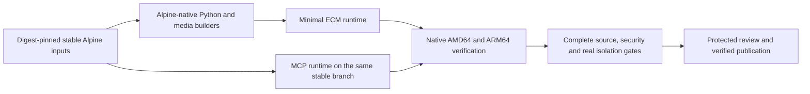

# ADR-017: Standardize application images on stable Alpine

- **Status:** Stable-Alpine build integration implemented; paired 0065 acceptance validated at `84473c96`; 0066 verification, independent review and publication pending
- **Date:** 2026-11-07
- **Bead:** `enhancedchannelmanager-2ixgf`
- **Tier:** ECM/MCP home-lab; image publication small-team. Effective scope: small-team.
- **Supersedes:** The openSUSE Tumbleweed target in [ADR-015](ADR-015-wolfi-native-runtime.md), not its security, source-delivery or media-compatibility requirements.

## Decision

### Delivery priority update — 2026-11-10

The PO directed: **"lets get the alpine containers done, we can worry about
shoring up the security issues later."** Finish stable-Alpine container build
integration and functional compatibility first. Further advisory remediation is
deferred to the follow-ups recorded in the
[completed advisory assessment](../design/stable-alpine-advisory-feasibility.md);
do not expand the owned-package cohort merely to reduce advisory counts.

This changes implementation order, not historical evidence or existing
production security checks. Keep unsuppressed scans and HIGH/CRITICAL/reviewed-P1
promotion checks. A working development container is not publication approval,
and bounded source consumers must continue reporting their actual scope rather
than claiming full source or advisory acceptance. Compatibility, source
integrity, identity and isolation requirements remain in scope.

The PO explicitly directed: **"We shouldn't be using rolling repositories. We
should be making this standard on alpine."** ECM's runtime and native builders
will migrate to a supported **stable Alpine release**, aligned with the MCP
sidecar. The first availability survey targets **v3.24**; actual package/security
and musl compatibility evidence must validate that choice before final image use.

Use digest-pinned, release-qualified image references and explicitly selected
stable `main`/`community` repositories. Do not use `edge`, `testing`, unqualified
`latest` inputs, SUSE/Packman RPMs, mixed distribution libraries, or a glibc
compatibility layer to make a nominally Alpine image work.

This decision changes the platform target. It does **not** authorize silently
dropping codecs/input formats, ignoring advisories, relaxing source checks,
lowering coverage, changing application behavior, merging or deploying.

The PO additionally requires **100% compatibility: it must work identically**.
The [parity acceptance matrix](../design/stable-alpine-parity.md) makes that a
cutover requirement: compare equivalent scenarios on the same application source,
retain all existing contracts, and leave every unverified difference blocked.
Package availability or a green dependency scan alone cannot clear the migration.

### Owned-library maintenance decision

After the authenticated stable-package survey, the PO explicitly selected
**"Own builds"** for Codec2, TwoLAME, Shine, libxml2, librsvg and Speex. Maintain
pinned, reviewed Alpine-native source builds/backports where stable packages
cannot retain the existing media/security contracts. This accepts the additional
patch, advisory, source and notice maintenance; it does not approve a particular
unverified build, library downgrade or cutover. Track implementation in
`enhancedchannelmanager-g3vd3` and the source/scanner follow-ups linked from
`enhancedchannelmanager-2ixgf`.

Authenticated historical vendor source payloads may establish the exact baseline
upstream/patch identities. They do not authorize installing foreign RPM binaries
or enabling a rolling repository in an Alpine build. The first codec build uses
upstream archives whose hashes independently match those signed source payloads.

## Why change

The previous security remediation selected Tumbleweed to obtain a sufficiently
current native-library graph while preserving existing media support. Actual
cold CI subsequently exposed removed base manifests, exact binary/source RPMs
and repository metadata. Fixing each expired mirror/object is not an acceptable
long-term platform strategy for this deployment.

The existing CA repair already installs official fixed certificates on both
architectures; this is a platform/reproducibility decision, not a reason to
replace trust verification or suppress the old advisory.

**Stable is not immutable.** A versioned Alpine repository still receives package
updates and can replace old revisions. A pinned base digest does not freeze a
later `apk add`/`apk upgrade`. Keep intentional patch updates and retain the exact
selected APKs, indexes and corresponding source/packaging inputs where necessary
for repeatable cold builds. Do not recreate the same expired-input problem with
different package suffixes. No new artifact service is chosen by this ADR.

## Phase 1: Prove and implement the replacement

1. Survey real stable APK indexes and vendor security data separately for
   x86_64/aarch64. Survey all 74 Python pins against actual CPython 3.12 musllinux
   distributions; old manylinux wheel receipts do not transfer to musl.
2. Preserve the signed FFmpeg source and approved RTSP patch. Prefer stable
   distro library packages; source-build unchanged approved upstream components
   only where actual evidence requires it, with explicit provenance and review.
   Do not select a vulnerable stock FFmpeg just to avoid a native build.
3. Exercise the real backend imports, SQLite, TLS/ACME, FFmpeg probing/relay/
   previews, rare software inputs, resdet, signals/cancellation and identity
   remapping. GNU-versus-BusyBox behavior must be tested rather than assumed.
4. Replace RPM-specific inventory/source/scan bindings with APK-specific checks
   derived from actual images. Preserve exact config/platform/rootfs binding,
   inventory completeness, source/notices and unsuppressed advisory detection.
   An RPM package count is not a portable security floor; an empty APK report
   must never pass because an old RPM assertion was simply removed.
5. Run native AMD64 and ARM64 full-image checks, both bootstrap identities,
   complete scans, full application gates and real Compose MCP isolation on the
   actual candidate. Require independent review before protected integration.

The initial targeted feasibility spike was evidence only, not a published runtime
or a passing migration. Current delivery evidence and its limits are recorded below.

## Phase 2: Keep stable builds maintainable

Use deliberate stable-release/base-digest and security-package refreshes, bounded
input retention and ordinary dependency/source tooling. Document rebuild/update
commands. Re-run both architectures on changes. Avoid introducing a new registry,
snapshot service or generalized packaging framework unless the actual retained
input set demonstrates a need.

## Enforcement and current limits

- `scripts/alpine_repository_policy.py` now checks actual Alpine release and
  repository files, rejecting `edge`, `testing`, cross-release/mixed/tagged feeds,
  missing/duplicate feeds and alternate endpoints. Its 26 regressions passed
  after the initial RED run, and it ran successfully read-only/offline against
  an existing immutable MCP image's actual `3.24.4` files. The fixture records
  that image identity rather than inventing a repository response.
- The root `Dockerfile` now composes the self-contained stable-Alpine build graph,
  including repository-policy checks, and MCP uses the aligned stable base.
  Stable feeds remain mutable; this is not complete builder/source closure.
- Paired native 0065 ECM candidates passed complete scans, 28 runtime checks each
  and both bootstrap identities in the acceptance validated at `84473c96`.
  Their embedded image source marker is `89ad115a`, not the validation head.
  See the [acceptance record](../design/stable-alpine-parity.md#current-delivery-status)
  for exact identities, CI runs and scope. Earlier SUSE successes and incremental
  Alpine failures remain historical evidence, not substitutes for these results.
- Preparation of `0.18.2-0066` does not inherit an exact-SHA native pass or
  publication result. Fresh CI, independent review, protected PR #1064 integration
  and verification of both ECM/MCP `:dev` publications remain required under
  `enhancedchannelmanager-2ixgf.3`. Advisory follow-ups above remain deferred;
  source checks remain bounded and production promotion checks are unchanged.
- Preserve draft #1063, all earlier owning branches and unrelated work. The
  migration starts in a separate checkout at committed `06cc4bf5`.

## Exit and unresolved decisions

Alpine is the accepted target, not one option awaiting another distribution vote.
If a stable package or musl/native source gap prevents a safe feature-complete
image, report the exact gap and the smallest Alpine-compatible correction.
Do not silently fall back to rolling/edge repositories or narrow supported media.
Deployment rollback remains an explicit operator action to a previously verified
immutable image; it is not permission to republish an affected historical image.
