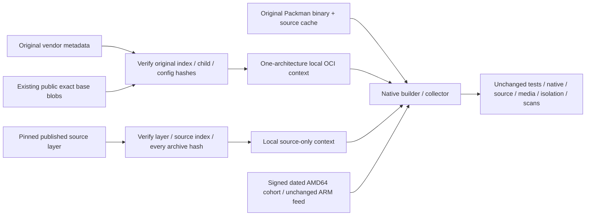

# Cold CI native-input recovery

Tracks `enhancedchannelmanager-8mhga`; isolated candidate authorized by the PO's
"Fix CI" request. This repairs input retrieval, not a release or deployment.
Original P1 branches, security floors and draft candidates are preserved.

## Observed failure chain

1. The pinned vendor index/AMD64 child/config/layer return 404 at their original
   endpoints. However, retained **raw** vendor index/manifests/configs rehash to
   their original identities, and the original base layers remain available as
   exact blobs in the existing public ECM repository.
2. Recovering the original base permits a real AMD64 BuildKit build with RUN
   networking disabled. The next unchanged cold build fails on eight expired
   exact builder providers in the rolling repository.
3. Authenticated official history cohort `20261022` contains **all 47 unchanged
   AMD64 builder pins**, including matching source filenames and original
   same-algorithm checksums. Its repomd SHA-256 is
   `0a3fba021cf5d1ec67008500aa1e3e7ccfe60a316cc625430955458b965aeb30`,
   revision `1792747441`, signed by the existing SUSE fingerprint
   `AD485664E901B867051AB15F35A2F86E29B700A4`.
4. A cold build against that cohort installs the complete builder set, then
   exposes a removed exact Packman codec URL. The 14 original codec binary/source
   inputs were retained; all hashes and original signatures verify. They total
   9,520,531 bytes, small enough for a bounded Git-retained bootstrap set without
   provisioning another registry or giving PR jobs registry write credentials.
5. Exact SUSE source URLs have expired independently. The already published,
   source-closed merge `0bc12600` retains per-architecture source layers. Its
   pinned AMD64 layer contains 156 source archives; ARM64 contains 155. Those are
   source archive carriers, not replacement application or base images.

## Candidate path

`scripts/recover_native_base.py` validates the recorded vendor graph, compressed
base hashes and uncompressed config diff IDs. It emits a complete layout for
only the requested supported architecture; it does not pretend to restore all
seven platforms of the original index. BuildKit uses that exact original child
through a named context while the Dockerfile's base digest remains unchanged.

For source recovery it first checks the exact published carrier manifest, source
layer digest/size, original source-index hash, architecture and count. It copies
only hash-bound regular RPM archive files, with path, size and completeness
checks. No tar payload is extracted into the image root, and no SPEC is run.
The source collector then re-verifies vendor signatures, exact headers and
Source/Patch closure using the unchanged keys and per-architecture expected
index. Transport recovery is not relabeled fresh vendor acquisition or reused
signature approval. A carrier receipt accompanies the final image's provenance.

Native bootstrap, builder and runtime AMD64 solves use the signed historical
`20261022` cohort, matching the original published runtime inventory. No codec,
compiler, Go, source version, key or approved FFmpeg patch is changed. ARM keeps
its architecture-specific feed and independent expected source set. Same-named
source files across architectures are never assumed byte-identical.

Both ECM Build jobs and the Compose MCP isolation build use the recovered inputs.
Compose uses a private docker-container builder because the Docker driver does
not support OCI layout contexts. Its private input directory stays inside the
checkout, excluded from the default Docker context and Git, so Bake requires no
broad filesystem-read entitlement. All runtime isolation assertions and both
PUID/PGID runs remain enabled.

## Verification and limits

- Metadata and source-loader unit tests include wrong hashes, architectures,
  missing/duplicate archives, links, path escapes and interrupted transfers.
- Native recipe tests refuse a rolling or differently dated builder route and
  require every original Packman cache object with no unindexed files.
- The actual AMD64 base was executed through both BuildKit and Compose with RUN
  networking disabled. That is base/context integration proof, **not** a final
  application, source-collector, native-media, isolation or image-scan pass.
- Current candidate native builds, both architecture output gates and full
  application/remote checks must actually complete before their results can be
  reported. No previous image's scan is attached to a newly built candidate.

This is a bounded recovery path, **not full ADR-016 implementation**. Dated SUSE
history still has finite upstream retention; this candidate does not archive
the full transitive binary closure or implement backup/GC policy. The existing
source carriers can also disappear if their published images are deleted.
`293n8` continues to own that larger retained-input transaction. Git's portable
small bootstrap set is a deliberate Phase-1 trade-off, not a proposal to store
all native packages in Git.

**CA/Brotli vendor holds remain.** Restoring old bytes does not meet newer security
floors. A red scan must remain red; no suppression, lowered floor, floating tag,
vendor-key change, unreviewed native fork, protected merge or deployment is
authorized by this candidate. Phase 2 is the separately reviewed complete
retention/update transaction, not removal of these gates.
