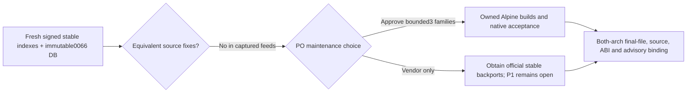

# Maintained SQLite, coreutils and GLib remedies

**2026-11-11 · evy2p · proposed, not approved or deployed.** Coordination:
`enhancedchannelmanager-uv80n`. Baseline is published, working 0066 commit
`95fc8e4e88c22744327de0ed75767ce5e8b28af9`, not the older investigation's images.
Calibrated for **small-team ci-release**, with home-lab data/DBAS compatibility.

## Decision for the PO

**Recommend authorizing exactly three additional maintained Alpine-native source
families on stable 3.24**, bounded as follows:

1. **SQLite:** complete corrected **3.54.1 library**, existing features/limits and
   `libsqlite3.so.0`; do not introduce the vulnerable CLI.
2. **coreutils:** retained **9.11** plus `d64e35a8`, `b60a159f`, `4ade9cf7`,
   **and** `52e5694f`, including original tests, GNU capabilities and all four
   installed split outputs.
3. **GLib:** retained **2.88.1** plus `656ad458` and `c9da977c`, including the
   original invalid-nesting regression and its ported registration.

This is a concrete **maintenance choice**, not approval inferred from “work all
P1s.” The alternative is obtaining equivalent **official signed stable 3.24
vendor backports**; none is present in the inspected feeds. Choosing vendor-only
leaves this P1 and promotion blocked until those packages actually exist and pass
source/ABI/native acceptance. It is not a technical waiver or permission to stop
other engineering work.

No stable-branch/cohort expansion, edge/testing feed, distro Python replacement,
74-pin application update, GNU feature removal or new production wiring occurs
in this proposal. Those are constraints for the proposed implementation, **not
claims already enforced by a new provider**.

## Fresh vendor result, not a version-only inference

All four **whole** main/community APK indexes were fetched over HTTPS and passed
`apk verify` using hash-reviewed architecture-specific official keys. A corrupted
index was rejected by the same instrument. ARM signature checking ran on AMD64;
it is **not ARM execution**. Complete tracker JSON-LD and fixed secdb documents
were acquired with the unchanged maintained snapshot helper, starting
`2026-11-11T15:58:42.729696Z`. This is historical decision evidence, not a future
six-hour gate input or proof that a publisher is complete.

| Source | Published0066 and current signed vendor, both architectures | Signed source recipe commit | Current remedy availability |
|---|---|---|---|
| SQLite | `sqlite-libs 3.53.4-r0` | `a9c3ba8b9129ec0f294d0a9bf538c2f1632bb016` | No corrected vendor library |
| coreutils | `9.11-r0`, including env/fmt/sha512sum splits | `8e261cdab4fd1bc77881cbff73b9ea962e9bd49f` | No corrected vendor revision |
| GLib | `2.88.1-r1` | `bd96e2db11c9ba7d7795454d16af620d577614c7` | No corrected vendor revision |

For each of the **six installed target outputs per architecture**, original
query origin/version and installed DB **control checksum, source commit,
architecture and origin** match the freshly verified index. The fixture tests
re-derive this join from recorded real stanzas and complete immutable inventories,
not from the table above. There are no matching replacement outputs hiding in
the inspected community indexes.

The complete field survey, attached to the bead before writing fixture tests:

- Main tracker: 185 items/185 unique CVEs; 292 stable states, all `fixed:false`.
- Community: 1994 items/1639 unique CVEs; 3847 raw/3085 unique stable rows;
  3084 `false`, one `true`. Embedded foreign branches were not mistaken for stable.
- Raw CVSS-vector distributions: main 180 missing, five 3.1; community 1561
  missing, 368 3.1, 53 3.0, **12 4.0** despite the `cvss3` field name.
- Fixed secdb contains 290/489 package rows. Opaque aliases/composites and version
  `0` remain evidence, **not automatic fix exemptions**.
- Whole index row counts: x86 main/community **5961/22708**; ARM **5983/22588**.

## Upstream release evaluation and source proof

| Alternative | Actual examined source result | Choice |
|---|---|---|
| SQLite 3.54.1 complete release | Canonical source SHA256 `387e7f6c…240c71b`; new official amalgamation SHA3 matches the primary download page. Loaded library source ID matches canonical manifest `555e07ef…e6ca76`. Existing eight straightforward fix contexts replay; authorization follow-up also reverse-matches, while CTE/later edits and initial authorization patch require semantic review. | Prefer complete corrected library over maintaining ten old-version backports. |
| coreutils 9.12 upstream release | Allocation and wide-blank changes present, but the **blank** branch still adds raw `c32width(g.ch)`. The negative-width patch applies unchanged. A clamp in the sibling nonblank branch does **not** fix it. Downloaded release signature is retained but not verified; no signed-release acceptance claimed. | Blind 9.12 bump is insufficient and broadens behavior changes. Prefer bounded 9.11 four-patch port. |
| GLib 2.88.4 latest 2.88 release | Official SHA256 matches. Still has the bad `<node>` parent condition and lacks `test_invalid`; the correction code applies, with the same registration-layout conflict. | Bare micro bump is insufficient. Prefer paired 2.88.1 backport over unrelated changes. |

Original primary correction URLs and retained source-feature review for each
SQLite correction are in
[`stable-alpine-advisory-feasibility.md`](stable-alpine-advisory-feasibility.md).
This assessment re-executed their source contexts locally against the exact
hash-bound canonical archives. It does not reinterpret patch-context success as
test execution or claim that a source archive is a delivered runtime correction.

## Actual prototype verification

New files under [`proofs/stable-remedies/`](proofs/stable-remedies/) are isolated
decision/proof artifacts, **not installed recipes or production gate changes**.

| Check and layer | Observed result | Boundary |
|---|---|---|
| Native AMD64/musl Python 3.12 SQLite behavior | Old vendor: **2 fail/1 pass**. Private 3.54.1: **3 pass**. FULL JOIN authorizer sees both tables; eleven small CTEs obey depth 11/12. FTS3/4/5, R-Tree, foreign keys and private in-memory backup roundtrip pass. | No attacker SQL payload, filesystem database or operator data. Not WAL/migration/DBAS/concurrency acceptance. |
| Dangerous incomplete SQLite authorization mutant | Recreated initial fix's `a[0]` iteration mistake: **1 fail/2 pass**, specifically missing authorization of `t2.x`. | Proves the test rejects the incomplete fix, not merely the original release. |
| Native AMD64/musl GLib parser behavior | Old exact parser: four original invalid vectors terminate their isolated child processes with SIGSEGV; empty/valid controls pass. Paired correction: **7 pass**. | Compiled parser unit, not rebuilt full GLib or original session-bus C test runner. |
| GLib original C regression port | Full test function retained; registration adapted from upstream slash-separated names to actual 2.88.1 hyphenated harness. | Port exists; full original C harness execution remains pending. |
| coreutils full source/test port | Four original code/test sets apply with **fuzz zero**; original uniq/allocation/wide regressions and THANKS retained; combined NEWS and negative-width musl regression added. | **No utility behavior PASS.** Prototype compile is unfinished. |

The host's **existing GCC 15.2** compiled private shared objects using
signature-verified stable musl/GLib development headers, with two-CPU/3-GiB
bounds. Native execution used cached `0c5586b42b0d`, `/proof/venv/bin/python`,
all 74 application pins verified, UID3000, no network, read-only source/root,
capabilities dropped and private disk-backed `/tmp`. Five GLib support libraries
came from already loaded published0066 AMD image `ca2fb0b9…`; their actual file
checksums match the recorded installed DB. The new SQLite mapping and whole-file
hash were inspected via `/proc/self/maps`, not just an executable version.
The old library loaded in the cached test image is also **whole-file identical**
to the locally loaded published0066 AMD image: SHA256
`4290ff1e86e8c9204789104aed2a2eb562d7292ed9544c5ba235759ea1ff3281`,
with equal loaded path and source ID. That binds the SQLite baseline red to the
actual published library bytes, not merely another package bearing the same name.

These are **not production Alpine-toolchain package builds**, native ARM64
execution, full ABI proofs, scans or final-image/source acceptance. GLib's private
parser configuration disables NLS only for this unit prototype; production must
retain the original feature contract.

The private coreutils build first failed because extraction mtimes unnecessarily
triggered absent Autotools; preserving archive mtimes corrected that without
source changes. The next attempt stopped in retained `lib/hard-locale.c` on
undefined `SETLOCALE_NULL_MAX`, `setlocale_null_r` and `streq`. No invented header,
stub or silent feature deletion was used. That is an **unfinished build-preparation
investigation**, not evidence of an upstream-unfixable vulnerability. Proposed
utility behavior tests are included but **unexecuted**; they are not counted in
the passing SQLite/GLib/recorded-evidence subset.

## Per-finding applicability and quantified risk evidence

The current target tracker has **15 records**: the 13 remedies here plus chroot
and SQLite CLI. Every target tracker CVSS is `0/null`, meaning **UNKNOWN**, not
0.0/Informational or Low. GLib's separately retained primary-vendor CVSS is
**7.5/High**. No effective ECM score is fabricated where attacker reachability
is unproven; such scores remain **unquantified**, not reduced to Low. Quantitative
coverage for the 13 fixes is **0/2 architectures of delivered corrected final
packages**. The bounded AMD64 units above are additional evidence, not clearance.

| CVE | Source-feature applicability / impact prerequisite | Numeric severity and residual risk |
|---|---|---|
| 2026-119371 | CTE parser enabled; depth exhaustion requires crafted SQL/schema path. Safe small-limit regression demonstrates changed behavior. | Tracker UNKNOWN; ECM effective score unknown; P1 |
| 2026-119372 | FTS3/4 enabled; snippet use-after-free requires affected query/database state. | UNKNOWN; path not demonstrated; P1 |
| 2026-119373 | FTS5 enabled; row-list merge overflow requires affected index/query. | UNKNOWN; path not demonstrated; P1 |
| 2026-119374 | FTS5 enabled; secure-delete overflow requires affected index/operation. | UNKNOWN; path not demonstrated; P1 |
| 2026-119375 | WAL supported; page-size disclosure requires affected database/WAL handling. In-memory prototype does not prove WAL safety. | UNKNOWN; final WAL proof pending; P1 |
| 2026-119376 | COLLATE expression parser present; crafted expression depth required. | UNKNOWN; path not demonstrated; P1 |
| 2026-119377 | Joined-column authorization API present; bypass matters to consumers relying on that boundary. Bounded callback regression and incomplete-fix mutant executed. | UNKNOWN; ECM reliance not established; P1 |
| 2026-119378 | R-Tree enabled; use-after-free requires affected index/query state. | UNKNOWN; path not demonstrated; P1 |
| 2026-119379 | Session/preupdate support enabled; changeset overflow requires affected session input/operation. | UNKNOWN; path not demonstrated; P1 |
| 2026-119591 | Count-of-view optimization present; crafted view/expression depth required. | UNKNOWN; path not demonstrated; P1 |
| 2026-56391 | GNU uniq delivered; multibyte `-w` read overrun requires crafted tool input. No direct ECM tool path established. | UNKNOWN; no non-use exemption; P1 |
| 2026-56392 | GNU unexpand delivered; allocation/wide/negative-width whitespace paths apply, including musl. | UNKNOWN; runtime regressions unfinished; P1 |
| 2026-58016 | GLib/GIO delivered; invalid D-Bus introspection nesting triggers parser memory-safety failure in bounded native prototype. Direct ECM D-Bus input path not established. | Primary 7.5 High; effective score unquantified; P1 |

Authenticated restore opens imported SQLite databases and `quick_check` is not a
parser memory-safety boundary. Authentication reduces exposure, not source
applicability. No arbitrary-SQL service endpoint or direct D-Bus parser call is
claimed. `CVE-2016-2781` remains a separate shared-TTY/chroot contract review;
`CVE-2026-119586` is not fixed by 3.54.1, and absent image CLI does not clear
external operator recovery tools. Neither is absorbed into the 13 fixes.

## Bounded maintenance cost, delivery and exit

| Route | Maintenance surface / trade-off | Exit |
|---|---|---|
| Official stable backports | No additional owned source family; still requires six installed output identities and both-architecture source/ABI checks. Currently unavailable. | Normal stable package refresh once actual fixes are proven. |
| Proposed three owned families | **3 recipes, 6 installed package outputs per architecture**; two patch series plus one release build, source/notice/compiler closure, signing, scans and future advisory monitoring. More ownership, least behavioral change from0066. | Retire each owned family independently when official stable source has equivalent fixes and both native final-image contracts pass. |
| Blind upstream release bumps | 9.12 and 2.88.4 are demonstrably incomplete; broader compatibility surface without removing ownership. | Rejected as a standalone remedy. |

**Phase 1:** after explicit approval, produce signed, accurately identified owned
outputs without impersonating official vendor packages; preserve exact sources,
notices and original tests. Resolve coreutils native build preparation, then run
native AMD64/ARM64 full-package tests, symbol/SONAME comparison, unchanged GNU
semantics, SQLite WAL/migration/concurrency/current+legacy DBAS, GLib dependent
media/introspection and gcompat checks. Bind compiler/static dependencies and
complete advisory dispositions to actual final files, with independent review.
This is **Large** bounded provider work, not a simple APK version edit.

**Phase 2:** upstream the bounded backports for stable-vendor adoption. The exit
trigger is source-fix equivalence **and** both-architecture final acceptance, not
“newer version” or disappearance from Trivy/secdb. No new registry/service or
recurring runtime infrastructure cost is proposed. Build/maintenance resource
cost is the three-family/six-output surface above; no invented calendar estimate.

Until those steps run, `evy2p` stays **in progress** and source/advisory acceptance
stays unresolved. The implementation trigger is the PO's explicit three-family
maintenance approval, tracked in `evy2p` under `uv80n`.

## Evidence and replay

- Machine-readable proposal:
  [`evidence/stable-remedies-20261111.json`](evidence/stable-remedies-20261111.json).
- Committed original-receipt capsule:
  `evidence/stable-remedies-20261111.receipts.json.gz`; includes complete recorded
  0066 inventory texts, selected original vendor stanzas/tracker items, full
  HTTP/hash/signature metadata, source witnesses, build commands and native logs.
  Excerpts are explicitly **not complete signed feeds**.
- Whole raw feeds/indexes/source archives and private outputs remain under
  `/tmp/opencode/ecm-evy2p-20261111`, hash-bound by the capsule. Source canonical
  archive remains at the prior assessment retention path, also hash-bound.
- [`proofs/stable-remedies/README.md`](proofs/stable-remedies/README.md) names the
  bounded replay selection and the unexecuted coreutils selection.

No version, CHANGELOG, SBOM, application, workflow, existing provider/gate helper,
runtime trust store or production source manifest was modified by this work.
