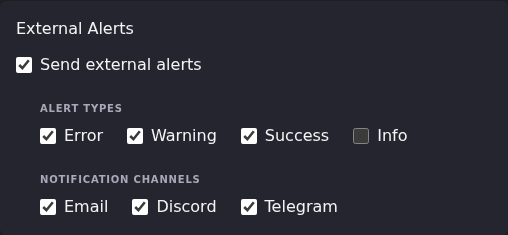

# Route Alerts to the Right Channel

After this article you will be able to send different severities and
different kinds of alert to different destinations, silence the noisy ones,
and predict which alerts reach which destination.

The gates an alert passes are described in
[Notifications & Alert Methods](index.md). This article assumes you have
read that, and covers the routing decisions that sit on top of them.

## Where routing is configured

Routing is configured in two places:

- **Settings → Scheduled Tasks → Edit**, per task: whether the task sends
  external alerts at all, which severities, and which destination types.
  Email, Discord, and Telegram have per-task channel toggles, and each
  toggle covers every destination of that type. ntfy does not have one.
- **Settings → Notification Settings → Alert Methods**, per destination:
  which severities and which alert categories that destination receives.
  Click **Edit** on its row.



Defaults for a task are: external alerts on, Error, Warning and Success
on, Info off, and all three channel types on. The **Notification Center**
block above it is separate and does not gate external delivery.

## One dispatch path for every alert

Every alert ECM raises goes to the destinations the same way: scheduled
task results, per-source EPG refresh results, per-account M3U refresh
results, stream probes, and everything else. Each alert carries one
category (see
[Choose what each destination receives](index.md#choose-what-each-destination-receives)),
and each destination decides from its severities and categories whether to
take it.

The difference between alerts is only where they start:

- **Scheduled task alerts** pass the task's own gates first (master toggle,
  severity, channel type), then each destination's filters.
- **EPG refresh, M3U refresh and non-scheduled stream probe alerts** have no
  task gates. They go straight to each destination's filters.
- **Scheduled `stream_probe` and `failed_stream_reprobe` completion alerts**
  are owned by TaskEngine. The task gates and each destination's **Stream
  probes** filter apply once, so no destination receives a duplicate.

Older versions had two paths: Discord and Telegram were sent directly from
one shared webhook and one shared bot, and never received EPG refresh, M3U
refresh or manual stream-probe alerts. They do now. If a migrated Discord or
Telegram destination is busier after upgrading, untick **EPG refreshes**,
**M3U refreshes** or **Stream probes** on it.

## The full gate order

For a scheduled-task alert, in order. The first gate that blocks decides.

1. **Send external alerts** on the task. Off means nothing leaves ECM.
2. The **Alert Types** checkbox matching the fired severity.
3. For Email, Discord, or Telegram destinations, the **Notification
   Channels** checkbox for that type. It covers every destination of the
   type. ntfy has no checkbox here.
4. For each enabled destination: its own **Severities** checkbox for the
   fired severity. Destinations created in the UI start with **Info**
   off; destinations migrated from the old shared Discord and Telegram
   settings start with everything on.
5. That destination's **Alert categories**: the alert's category must be
   ticked, and for EPG refreshes, M3U refreshes and Stream probes the extra
   filter must let it through.
6. The 30-second digest window, then the send.

Email destinations also need SMTP configured and a non-empty recipients
list.

Gates 1 and 2 stop the alert everywhere. Gate 3 stops it for one type.
Gates 4 and 5 stop it on one destination while the others still fire.
Alerts that are not scheduled-task results start at gate 4.

## Timing: every destination is batched

ECM holds alerts for 30 seconds from the first one queued, then sends each
destination what it collected as one digest, titled like `ECM Digest (1 succeeded, 2 failed)` (an email
subject reads like `ECM Digest: 1 success, 2 error`). A single alert in the
window is sent on its own. This applies to Discord and Telegram as well as
email and ntfy, and the window is fixed in code.

Do not read a delayed or merged notification as a failure: it can arrive
about 30 seconds after the event.

## Worked examples

### Errors only to one Discord channel, everything to Telegram

Each destination has its own severities, so this is a per-destination
setting rather than a per-task one.

1. Under **Alert Methods**, click **Edit** on the Discord destination for
   the errors channel (or **Add Discord or Telegram** to create it).
2. Under **Severities**, tick only **Errors**. Click **Save changes**.
3. Click **Edit** on the Telegram destination and tick **Errors**,
   **Warnings**, **Successes** and **Info**. Click **Save changes**.
4. In each task you care about, leave **Send external alerts** on, tick
   every severity you want anyone to receive under **Alert Types**, and
   tick **Discord** and **Telegram** under **Notification Channels**.

**Result:** errors reach both. Warnings, successes and info reach only
Telegram. The row summaries read `Errors · all categories` and
`All severities · all categories`.

The task's **Alert Types** still apply first: if a task has **Info**
unticked, its info alerts reach neither destination. The same approach
works for email: edit the `Email` row's severities.

### Stop EPG refresh noise from one Discord destination

1. Click **Edit** on the Discord destination.
2. Under **Alert categories**, untick **EPG refreshes**. To quiet only some
   sources instead, leave it ticked, choose **All except the selected**,
   and pick the noisy EPG sources.
3. Click **Save changes**.

**Result:** that destination no longer receives per-source EPG refresh
results (or no longer receives them for the sources you picked). Other
destinations still do. The row summary reads `1 category off` or
`1 filtered`.

This does not silence the **EPG Refresh** scheduled task's own start and
completion alerts, which are in **Scheduled task results**. To quiet that
task on Discord, untick **Discord** under its **Notification Channels**.

### Silence success noise

Successful runs are the most common source of alert fatigue, and they are
on by default.

For one task, everywhere:

1. Open each task you want quieter.
2. Under **Alert Types**, untick **Success**.
3. Save.

**Result:** that task alerts only on warnings and errors. Its successful
runs still appear in the Notification Center if **Show notifications in
bell icon** is on, so you keep the record without the notification.

For one destination, from every task: click **Edit** on the destination
and untick **Successes** under **Severities**.

### Turn on info alerts for one task only

1. Open the task and tick **Info** under **Alert Types**. Save.
2. On each destination that should receive them, click **Edit** and tick
   **Info** under **Severities**. Destinations created in the UI start with
   it off.

**Result:** info alerts from that task reach those destinations. Other
tasks keep **Info** unticked under their own **Alert Types**, so their info
alerts stay home. Alerts that are not from scheduled tasks have no task
gate, so a destination with **Info** ticked also receives their info
alerts; untick their categories on that destination if that is too much.

### Route one EPG source's results to a different destination

Each destination's **EPG refreshes** category takes a source filter: **All**,
**Only the selected**, or **All except the selected** EPG sources. **M3U
refreshes** has the same filter over M3U accounts. To send one EPG source's
results to a separate Discord channel:

1. Add a Discord destination for that channel. Under **Alert categories**,
   set **EPG refreshes** to **Only the selected** and pick the source.
   Untick every other category.
2. If your main destination should no longer receive that source, edit it
   and set **EPG refreshes** to **All except the selected** with the same
   source.

To send a source's results to a different email recipient set, you still
need a second SMTP destination, which the UI cannot create. See
[API reference → Alert Methods](https://github.com/MotWakorb/enhancedchannelmanager/blob/main/docs/api.md#alert-methods)
in the repository.

### Stop a noisy probe from alerting until it is really bad

Click **Edit** on the destination, and under **Stream probes** set *Alert on
a probe with failures only when at least N streams failed*. A probe alert
reporting fewer failures than that is not sent to that destination; a probe
with no failures always goes through.

The same filters can be set through the API, for scripting. This keeps EPG
source `5` off the destination, raises the probe threshold to 3, and turns
off Emby alerts:

```json
PATCH /api/alert-methods/12
{
  "alert_sources": {
    "version": 1,
    "epg_refresh": {"filter_mode": "all_except", "source_ids": [5]},
    "probe_failures": {"min_failures": 3},
    "emby": {"enabled": false}
  }
}
```

`alert_sources` is replaced as a whole, so include every section you want
to keep. The full schema is in
[API reference → Alert Methods](https://github.com/MotWakorb/enhancedchannelmanager/blob/main/docs/api.md#alert-methods).

## Choosing a channel deliberately

| If you want | Use |
|-|-|
| A durable record you can search later | Email. Every alert is a message, and the digest keeps them grouped |
| A shared team feed | Discord. One destination per channel, as many channels as you like |
| Something on your phone | Telegram, or ntfy for a public or self-hosted push target |
| Separate feeds for different kinds of alert | Several Discord or Telegram destinations, each with its own severities and categories |
| No external delivery, just a record in ECM | Turn **Send external alerts** off and leave **Show notifications in bell icon** on |

## When routing does not behave

| Symptom | Cause to check first |
|-|-|
| One destination silent, others of the same type fine | That destination's **Enabled**, **Severities** and **Alert categories**. The row summary shows its filters |
| Every destination of one type silent for one task | That task's **Notification Channels** toggle for the type |
| All channels silent for one task | **Send external alerts** on that task |
| All channels silent for one severity | The **Alert Types** checkbox for that severity |
| Info alerts reach one destination but not another | Expected when **Info** is ticked on one and not the other. Gate 4 above |
| EPG or M3U refresh alerts reach a destination you did not expect | Expected. Every destination receives them unless that category is unticked on it |
| A scheduled task reaches ntfy even with all three channel boxes off | Expected. ntfy has no per-task channel toggle; the task master/severity gates and method filters still apply |
| Alerts arrive late or merged | Expected. The 30-second digest window, on every destination type |

Dispatch decisions are logged. A task logs its full alert configuration
before dispatching, and the dispatcher logs which channels it attempted
and which succeeded, under `[NOTIFY-SVC]` and `[ALERTS]` prefixes. Skips
are logged with the reason, at debug level. See
[Read the logs](../troubleshooting/read-the-logs.md).

## Going deeper

- [Notifications & Alert Methods](index.md): the gates, the alert
  categories, and the Notification Settings page.
- [Manage the Email Alert Recipients list](email-recipients-deep-dive.md):
  the recipients field, the digest window, and the alert method behind it.
- [What ECM posts to Discord](discord-webhook-customization.md): message
  format and the limits of Discord customization.
- [Set up the Telegram bot](telegram-bot-setup.md): the two fields and
  their failure modes.
- [API reference → Alert Methods](https://github.com/MotWakorb/enhancedchannelmanager/blob/main/docs/api.md#alert-methods) (GitHub):
  everything the UI cannot configure, including additional SMTP methods and
  the `alert_sources` schema.
- [API reference → Scheduled Tasks](https://github.com/MotWakorb/enhancedchannelmanager/blob/main/docs/api.md#scheduled-tasks) (GitHub):
  updating per-task alert configuration without the UI.
